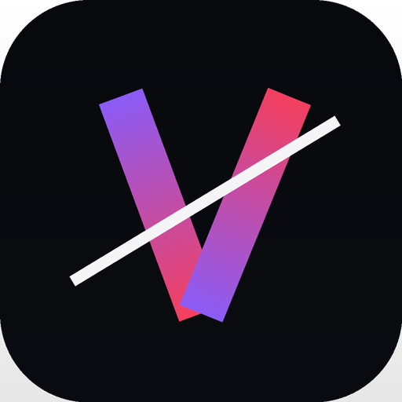

<p align="center">
  
</p>

<h1 align="center">VantaCut Studio</h1>

<p align="center">
  <b>A cinematic video-editing studio for Android, built on the open-source <a href="https://github.com/artcraft-android/filmcraft-android">FilmCraft for Android</a> app and the <a href="https://github.com/storytold/filmcraft">FilmCraft</a> Rust engine, with a Kotlin/Jetpack Compose UI.</b><br>
  Many credits to the FilmCraft and storytold maintainers, whose engine and app this project builds on.
</p>

<p align="center">
  
  
  
  
  
  
</p>

VantaCut Studio is one coherent product: the FilmCraft app and engine, rebranded and extended.
Everything runs locally on the phone — no account, no cloud, no ads, no analytics. Large AI
models (speech, voices) are downloaded only when the user activates the feature that needs them.

## Identity

* Deep black and graphite surfaces (`#08090D`, `#151720`, `#20212B`), neon violet (`#8B5CF6`) and
  deep red (`#F43F5E`) accents, white typography (`#F5F5F7`, `#A6A6B5`).
* One place for the brand: `apps/filmcraft-android/android/app/src/main/java/studio/vantacut/app/Brand.kt`
  (names, links, credits) and `ui/Theme.kt` (`Vc`, `VcType`, `VcSize`, the `VantaCutFont` family).
  The product name is provisional and changes in one file.
* Type: **Cairo** (SIL OFL 1.1) for Arabic beside **Inter** (SIL OFL 1.1) for Latin, resolved
  per character so mixed Arabic/English text renders correctly. Arabic is designed for, not just
  translated: the text engine shapes Arabic (harfrust) and orders it (unicode-bidi), and Cairo is
  bundled with the engine so it works with no system font.
* Package identity: `studio.vantacut.app`.

## Editing

* Start from your photo library, from files or blank; open videos shared from other apps.
* Trim, move, reorder, split, delete, duplicate and replace clips; undo and redo; pinch to zoom.
* Speed from 0.1× to 10× (the sound keeps its pitch), freeze frames, volume, fades, extract audio.
* Record a voiceover.
* Multi-track timeline with visible video, audio, text and caption lanes.

## Filters, effects and transitions

* **37 cinematic filters** — including bleach bypass, midnight, golden hour, blockbuster, silk and
  crimson — previewed on the clip, with an intensity slider.
* 23 effects, opacity, mirror and flip; move, scale and turn clips on the preview.
* **67 transitions**, intros and outros, apply to all.
* **Watermark tool**: put your own text or picture over the whole video — any corner, adjustable
  opacity, removable in one tap.

## Captions and text

* Captions made on the phone by a speech model (Whisper, downloaded once when you ask), then
  edited, styled and burned into the video. The Whisper workflow and its model-download behaviour
  are unchanged.
* **Caption import**: SRT, WebVTT, TTML, SCC, MCC and EBU STL files become editable caption clips
  on the timeline in one undo step, keeping the track's look.
* **Caption export**: the caption track writes back out as an SRT sidecar.
* **Twelve caption looks** — Classic, Clean, Minimal, Bold pop, Broadcast, Violet, plus the luxury
  set: Neon, Cinema, Impact, Gold, Typewriter and Reel.
* **Full look controls**: font family, fill and background colours, outline width and colour, line
  spacing and margin — sliders and swatches in the captions panel.
* **Fonts**: 20 faces bundled (Arabic display, Latin display, script and mono, all SIL OFL 1.1),
  and a **Fonts screen** that downloads 52 more Google-Fonts families on demand and registers them
  with the engine for captions and text alike.
* Arabic and mixed Arabic/English captions: shaped, wrapped and laid out right-to-left.
* Text with presets, the phone's fonts, colours and layout.

## Export

* 720p, 1080p or 4K at 24 to 60 fps, saved to your Movies folder and ready to share.

## Status: what works, what is experimental, what is deferred

| Area | Status |
|---|---|
| Full FilmCraft editing, timeline, projects, speech and export | ✅ working |
| VantaCut rebrand (theme, icon, fonts, screens, package identity) | ✅ working |
| Caption import (6 formats), SRT export, 12 caption looks, full look controls | ✅ working |
| Arabic shaping, RTL and wrapping in the text engine (Cairo + Arabic display fonts bundled) | ✅ working |
| Watermark (text or image, corner, opacity) | ✅ working |
| Font downloads (52 Google-Fonts families, in-app) | ✅ working |
| 67 transitions incl. cube spin, whip pan, clock wipe, checkerboard | ✅ working |
| Downloading effects from a remote API/service | ⏸ deferred (no key-free open API found; more built-in presets shipped instead) |
| Six new cinematic filter looks | ✅ working |
| Compose UI tests for the new workflows | 🟡 not yet written (see TESTING.md) |
| Word-by-word/karaoke caption highlighting, Auto Lyrics | ⏸ deferred (needs word timings) |
| Word-art, speech bubbles, text animations, stickers, drawing | ⏸ deferred |
| GIF/still export, sound-effect library | ⏸ deferred |
| Speed curves, masks, chroma key, tracking, stabilisation, background removal, voice isolation, auto-reframe, collage, advanced colour grading | ⏸ Phase 3, deferred |

See [FEATURE_MATRIX.md](FEATURE_MATRIX.md) for the full per-feature matrix,
[MIGRATION_PLAN.md](MIGRATION_PLAN.md) for the plan and ground rules,
[LICENSE_REVIEW.md](LICENSE_REVIEW.md) for the licensing analysis, [CHANGELOG.md](CHANGELOG.md)
for what changed, and [TESTING.md](TESTING.md) for test results.

## Building Instructions

*One Gradle command builds the whole app: it compiles the Rust engine with
[cargo-ndk](https://github.com/bbqsrc/cargo-ndk) and generates the Kotlin bindings.*

* Clone this repository
* Make sure you have at least 4 GB of free disk space
* enter `apps/filmcraft-android/android` and run `./gradlew assembleDebug`, or open that folder in
  Android Studio and press Run.

Verified toolchain (the versions this repository is tested with):

```
    JDK 17 or newer (tested: Temurin 17.0.21+9)
    Android SDK, platform android-37.0 and build-tools 37.0.0
    Android NDK 29.0.14206865
    cargo-ndk 4.1.2 (cargo install cargo-ndk --version 4.1.2 --locked)
    Rust: the release rust-toolchain.toml names (rustup toolchain install)
```

The first APK targets `arm64-v8a`; build it explicitly with:

```
    ./gradlew assembleDebug -Pfilmcraft.abis=arm64-v8a
    ./gradlew assembleRelease -Pfilmcraft.abis=arm64-v8a
```

On a memory-constrained machine, keep the Gradle daemon off and cap the build:

```
    CARGO_BUILD_JOBS=2 GRADLE_OPTS="-Dorg.gradle.jvmargs=-Xmx2048m -Dkotlin.daemon.jvm.options=-Xmx1024m" ./gradlew assembleDebug -Pfilmcraft.abis=arm64-v8a --no-daemon
```

Rust tests: `cargo test --workspace` from the repository root.

*Builds are tested on Linux (x86_64); the upstream project tested Windows 11.*

## License

[MIT](LICENSE-MIT) OR [Apache-2.0](LICENSE-APACHE), at your option, like FilmCraft for Android.

Bundled typefaces (SIL OFL 1.1): Inter and Cairo — see `assets/fonts/*.attribution`,
`assets/fonts/OFL-Cairo.txt` and `ATTRIBUTION.md`.

If code from CapCraft (AGPL-3.0-or-later) is ever adopted, the combined work's obligations change;
[LICENSE_REVIEW.md](LICENSE_REVIEW.md) tracks that decision. No CapCraft code is included today.

VantaCut Studio is not affiliated with Adobe; Premiere is a trademark of Adobe Inc.

## Misc info for myself

Try to use [semantic commit](https://kapeli.com/cheat_sheets/Semantic_Commits.docset/Contents/Resources/Documents/index)
messages. Use `feat:` / `fix:` / `chore:` / `docs:` / etc.
